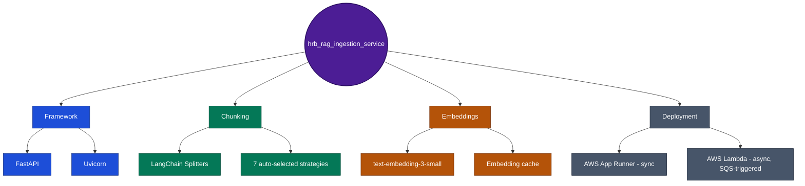

# hrb_rag_ingestion_service

Ingestion half of the HRB chatbot RAG pipeline: extract -> chunk -> embed -> index, plus document metadata/dedup/supersedes. Extracted out of `hrb_chatbot_service`'s monolith into two independently-deployed paths from the same code: a sync App Runner container (admin-triggered upload) and an async Lambda (S3-event-triggered).

## For reviewers / new team members (5 minutes)

1. Run it locally (below) and hit `GET /ping`.
2. [Batch/async pipeline diagram](../docs/architecture/diagrams/rag-ingestion-batch-pipeline.drawio) - the event-driven flow: S3 upload -> SQS -> Lambda -> parse/chunk/embed/index, and its status machine.
3. [Deployment architecture](../docs/architecture/diagrams/rag-ingestion-deployment-architecture.drawio) - both deploy targets (App Runner + Lambda), same ECR account, same secrets.
4. [Target state (scaling)](../docs/architecture/diagrams/rag-ingestion-service-target-state-scaling-architecture.drawio) - 2 operational gaps to close before any new scale work matters.

## Live demo

Not directly browsable - this is the ingestion path behind
**[hrb-chatbot-ui.rvsree.dev](https://hrb-chatbot-ui.rvsree.dev)**'s Admin
Dashboard document-upload feature. To see it work: log in as an `hr_support`
persona (e.g. `EMP051` / Hana Support) and upload a PDF from the Admin
Dashboard, or watch an S3 upload trigger the async Lambda path.

## Tech stack at a glance



See the detailed "Tech stack" table below for exact package names and versions.

## Quick start

```bash
pip install -r requirements.txt
uvicorn rag_ingestion.main:app --host 0.0.0.0 --port 8300 --app-dir src --reload
curl http://127.0.0.1:8300/ping
```

Tests: `pytest tests/ -v` from the repo root.

## Tech stack

| Layer | What's actually used |
|---|---|
| Framework | FastAPI + Uvicorn |
| Chunking | LangChain text splitters (`langchain-text-splitters`, `langchain-experimental`) - 7 strategies, auto-selected per document |
| Embeddings | `langchain-openai`, `text-embedding-3-small` default, with an embedding cache |
| Shared code | `hrb_common_libs[observability,db,vectorstore,llm,storage,cache]`, pinned to `v0.4.0` |
| Sync deploy | AWS App Runner (Docker, 2-stage build), 256 CPU / 512 Memory |
| Async deploy | AWS Lambda, container image, 3008 MB memory, 300s timeout, SQS-triggered |

## Status, 2026-10-24: both paths live in production, cutover complete

Two independent deployments of the same pipeline, both verified against real AWS state (`aws apprunner`/`aws lambda`/`aws sqs`/`aws s3api` CLI calls, not assumed):

- **Async (Lambda)** - `rag-ingestion-index-document`, triggered by the real production SQS queue (`hrb-chatbot-ingest-queue`) on an S3 upload to `hrb-chatbot-kb-uploads` (direct S3-to-SQS notification, no EventBridge - confirmed via `get-bucket-notification-configuration`). The old monolith's own Lambda (`hrb-chatbot-index-document`) is disabled, not deleted - its SQS trigger is confirmed `Disabled`, reversible.
- **Sync (container)** - deployed to AWS App Runner (`https://wkfgxanevz.us-east-1.awsapprunner.com`) for the admin-triggered upload/reindex/list/delete routes.

**2 operational gaps, not yet fixed, see the target-state diagram:** `.github/workflows/deploy-lambda.yml` still has a placeholder `ECR_REPOSITORY` value - the Lambda's current code was shipped by hand, not by this CI workflow, the exact same bug class `hrb_chatbot_service` already got bitten by once for its own (now-retired) ingestion Lambda. And no reserved concurrency is set on the Lambda, so a large bulk upload could compete with the rest of the account's shared concurrent-execution pool.

See `ROADMAP.md` for phase history, including 2 bugs found and fixed during live testing (a missing `git` package for the pinned dependency install, and an implicit-model-resolution bug that bypassed Secrets Manager for `OPENAI_API_KEY`).

## Documentation index

| Doc | What it covers |
|---|---|
| [Overview / Spec / Architecture / Design / Decisions / Interview FAQ](../docs/rag-pipeline/ingestion/rag-ingestion/) | The full HTML doc set for this service |
| [Build process](../docs/deployment-and-ops/build-and-deploy/04a-rag-ingestion-service-build-process.html) | Docker build, step-by-step, both deploy targets covered |
| [Deployment architecture (HTML)](../docs/deployment-and-ops/build-and-deploy/04b-rag-ingestion-service-deployment-architecture.html) | Same content as the `.drawio` above, narrative form |
| [`microservices-rollout-plan.html`](../docs/architecture/microservices-rollout-plan.html) | Why ingestion was split out first, in dependency order |
| [`platform-overview.html`](../docs/architecture/platform-overview.html) | The cross-service hub - business capabilities, all 7 repos, one diagram |

Older paths under `docs/dev-reference/rag-ingestion/` (no `hrb_chatbot_v3/` prefix) referenced in earlier commits are stale - that folder was reorganized 2026-10-23, and the links above reflect the current location.
